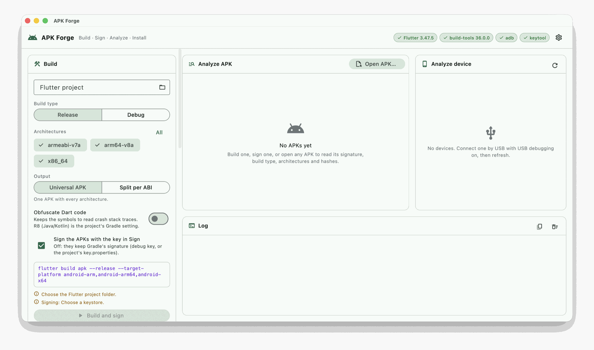

# APK Forge

A desktop app to **build, sign, verify and install Android APKs** from one
screen, instead of remembering the flags of `flutter build`, `zipalign`,
`apksigner`, `keytool` and `adb`.

APK Forge doesn't reimplement any of them. It drives the official tools you
already have installed, shows the exact command before and while it runs,
and streams every line of output into a log. When something fails you see
the tool's own reason, not a generic error.



## Features

| Panel | What it does |
|---|---|
| **Defaults** | What Build and Sign share, set once at the top: the architectures (any mix of `armeabi-v7a`, `arm64-v8a` and `x86_64`) and the signature schemes (Auto, or the ones you mark). Build and Sign show what they take from it. It folds into one line. |
| **Build** | Runs `flutter build apk` on any Flutter project, for the architectures in Defaults. Choose release or debug, and one universal APK or one APK per ABI (`--split-per-abi`, offered with two or more architectures). Optional Dart obfuscation keeps the symbols you need to read crash traces. The command is previewed before you run it. |
| **Sign** | Signs the APK selected in Analyze APK, the APKs a build just produced, or any APK you pick (from CI, another machine, a store), with your `.jks`, `.keystore` or `.p12` and the schemes in Defaults. It checks the alignment first and fixes it if needed, writes `<name>-signed.apk` without touching the original, and verifies that the result carries exactly the key you chose. **Split per ABI and sign** turns a universal APK (one from CI, say) into one signed APK per architecture in Defaults. |
| **Analyze APK** | For any APK: whether the signature verifies; the schemes it carries (v1 to v4); the signer certificate (DN, SHA-256, SHA-1), a rotated key's lineage, and whether it is **your key** or the Android debug key; release or debug (`debuggable`); package, version and SDK levels; native code per ABI, flagging an ABI with no Flutter engine; size, MD5 and SHA-256. **Compare with…** puts it next to another APK (a previous release, another build) or the app installed on the device, and lists every difference, worst first: another signer, a lower versionCode, a debug build, lost ABIs, new permissions. |
| **Analyze device** | For the device on USB: maker, brand, model and codename; Android version, API level, security patch, build and build type; chip, ABIs, memory page size (16 KB pages are flagged), RAM, storage and screen; battery, locale and time zone. With an APK selected, it tells you which ABI the APK would run as, which version is installed, and whether installing would be a fresh install, an upgrade, a reinstall or a downgrade, or would be refused for another key. **Compare with the installed app** compares the two side by side. One click copies it all as text. |
| **Install** | Installs the selected APK with `adb install -r` (optionally `-d` to allow a downgrade). It warns first when the APK has no native code for the device, or is signed with another key than the installed app, and explains the common install failures. |
| **Log** | Every command and its output, live, with errors and warnings colored. A failed step also shows its reason in a banner above the log, Gradle's "What went wrong" included. **Cancel** stops the running step. |

## Requirements

| Tool | Used by | Where it comes from |
|---|---|---|
| Flutter SDK | Build | [flutter.dev](https://docs.flutter.dev/get-started/install), on your `PATH` or set in Tools |
| Android SDK build-tools: `apksigner`, `zipalign`, `aapt2` | Sign, Analyze APK | Android Studio → SDK Manager |
| Android SDK platform-tools: `adb` | Analyze device, Install, comparing with the installed app | Android Studio → SDK Manager |
| A JDK: `keytool`, and Java for `apksigner` | Sign | Android Studio's bundled JDK works |

You don't configure paths by hand. At startup the app reads your login
shell's environment, the same one your terminal has. An app opened from
Finder or the Dock otherwise gets a bare `PATH`. It then looks at
`ANDROID_HOME`, `ANDROID_SDK_ROOT` and the default SDK folder for each OS,
and picks the newest build-tools.

The pills in the top bar show what was found. The gear lets you point to a
different Flutter or Android SDK.

### Platforms

| OS | Status |
|---|---|
| macOS | Tested |
| Windows | The code handles its paths and tool names (`apksigner.bat`, `adb.exe`, `%LOCALAPPDATA%`); not tried yet |
| Linux | The code handles its paths and tool names; not tried yet |

## Getting started

```bash
git clone https://github.com/xamiell/apk-forge.git
cd apk-forge
flutter pub get
flutter run -d macos
```

To build the app itself:

```bash
flutter build macos --release
# → build/macos/Build/Products/Release/APK Forge.app
```

The macOS app runs **without the App Sandbox**, because a sandboxed app
can't start `flutter`, `adb` or `apksigner`. A local build isn't notarized.
If you copy it to another Mac, Gatekeeper may block it. Right-click it and
choose Open, or remove the quarantine flag:

```bash
xattr -dr com.apple.quarantine "/Applications/APK Forge.app"
```

## Using it

### Build and sign a Flutter app

1. **Defaults:** choose the architectures, and the signature schemes if
   you don't want apksigner to pick them. Fold the card once they're set.
2. **Build:** choose the project folder, release or debug, and the output
   (universal or split per ABI). Turn on obfuscation if you want it.
3. **Sign:** choose your keystore, enter its password, press **Load keys**
   and pick the key. The panel shows the key's owner and SHA-256, so you can
   confirm it's the right one before signing.
4. Press **Build and sign**. The build output streams into the log. Every
   APK the build produced is then signed and verified, and the last one opens
   in **Analyze APK**.

Uncheck **Sign the APKs with the key in Sign** to keep Gradle's own
signature: the debug key, or the project's `key.properties`.

### Re-sign an APK you already have

Open the APK in **Analyze APK**, load a key in **Sign** and press
**Sign `<name>`**: Sign works on the APK selected in Analyze APK. **Sign
other APK files…** picks one or more APKs instead. Each one is written next
to the original as `<name>-signed.apk`, or to the output folder if you set
one.

### Split a universal APK per ABI

When CI hands you one universal APK, open it in **Analyze APK** and press
**Split `<name>` per ABI and sign** in **Sign**. It writes one signed APK per
architecture in Defaults, `<name>-<abi>-signed.apk`, next to the original or
to the output folder; the caption under the button says which ones before
you press it. Each one keeps everything but the other ABIs' `lib/` folders: for a
`flutter create` sample, the 42.1 MB universal APK gives 14.8 MB for
`arm64-v8a`, 12.1 MB for `armeabi-v7a` and 16.1 MB for `x86_64`.

- An architecture in Defaults that the APK has no native code for gets no
  APK, and one the APK has but Defaults doesn't is left out. The log says
  so.
- An ABI with native code but no Flutter engine gets no APK: it would crash
  at launch. The log says so.
- An APK with native code for one ABI or none is signed as it is.
- The splits keep the universal APK's `versionCode`. That's fine to install
  or to share directly. Google Play needs a different `versionCode` per APK:
  publish an App Bundle there, or build with **Split per ABI** in **Build**,
  which adds an offset per ABI.

### Check an APK

Press **Open APK…** in **Analyze APK**. The checks at the top of the report
say what matters:

- signed with your key, or with the Android debug key;
- release or debug;
- whether the signature verifies;
- architectures without a Flutter engine.

With a key loaded in **Sign**, the report also says whether that keystore
signed the APK.

### Compare two APKs

Select an APK in **Analyze APK** and press **Compare with…**. Pick the
reference: another APK of the session, a file (a previous release), or the
app installed on the selected device. The selected APK is compared as an
update over the reference:

- **The signer.** It is the same signer, a **rotated key** (APK Signature
  Scheme v3: Android still accepts the update), or a different signer, with
  both SHA-256 digests.
- **Whether it installs as an update.** If it doesn't, the comparison says
  why: another package, another signer, a lower versionCode, or a signature
  that doesn't verify.
- **Every difference, worst first,** each with why it matters: the
  signature, the manifest (versions, SDK levels, debuggable, permissions
  added and removed), the native code per ABI and the Flutter build, and the
  file. The values that are the same are folded.

A part that couldn't be read in either APK (a missing tool, a file that
isn't an APK) is listed as not compared, never as a difference. **Swap**
turns the comparison around.

### Inspect a device and install

Connect a device by USB with USB debugging on, and press refresh. The first
ready device is selected; with several connected, pick one in **Analyze
device**. With an APK selected, **Analyze device** says what installing it
would do. **Install** installs it.

When the APK's app is already installed, **Install** warns before an
install Android would refuse because the APK is signed with another key.
**Compare with the installed app** shows everything that differs. For that,
the installed APK is copied to a temporary folder, read and deleted. An app
installed from Play comes as a `base.apk` plus splits; the base and the ABI
splits are compared, and the density and language splits stay on the
device.

## Security

- **Passwords stay in memory.** They are never written to disk or settings,
  and they're gone when you quit.
- **Passwords never go on a command line.** `apksigner` and `keytool` read
  them from environment variables (`--ks-pass env:…`, `-storepass:env …`),
  so they don't show up in `ps`. Any output line that contains one is masked
  in the log and in error messages.
- **The app saves only paths and choices** (project folder, keystore path,
  key alias, architectures…), in the OS's standard app preferences.
- **Reading a device changes nothing on it.** It runs `getprop`, `wm size`,
  `dumpsys battery`, `pm path` and similar read-only commands. A package name
  taken from an APK is validated before it goes into a device shell command.
  To compare with an installed app, `adb pull` copies its APK files to a
  temporary folder, which is deleted once they are read.

## Things worth knowing

- **apksigner and v1.** For an APK with minSdk 24 or higher, `apksigner
  verify` reports `v1: false` even when a v1 signature is there, because
  Android 7+ ignores it. Analyze APK, Compare and a profile run's History
  read the APK's files too, and show "v1 present".
- **A rotated signing key.** With APK Signature Scheme v3 an app can move
  to a new key and still update over installs signed with the old one.
  `apksigner verify` shows only the new key, so on its own a rotated key
  looks like another key. Analyze APK also runs `apksigner lineage` for a v3
  signature, and Compare calls it "Key rotated". With v3.1 (API 33+), the
  report lists one signer per API range.
- **v4 signatures** go in a separate `<apk>.idsig` file next to the APK.
  apksigner writes it on its own when its defaults call for it. You only need
  it for `adb install --incremental`. `apksigner verify` checks v4 only when
  it's given that file, so Sign and a profile run pass it. Analyze APK reads
  the APK alone, so it shows v4 as not verified.
- **`--target-platform` only filters the Flutter engine.** A plugin's own
  `.so` files can still make the APK advertise an ABI you left out. A device
  that picks that ABI crashes at launch. Analyze APK flags it as "No Flutter
  engine for …". Drop the ABI with `ndk.abiFilters` in Gradle.
- **A 64-bit chip doesn't mean a 64-bit device.** Some devices ship 32-bit
  firmware and only accept `armeabi-v7a`. Analyze device shows the ABIs the
  device actually reports.
- **Obfuscation symbols.** Flutter skips the Dart compile when nothing
  changed, and with it the symbols, so a deleted symbols folder stays empty.
  The log warns about it; `flutter clean` fixes it.
- **R8** (Java/Kotlin shrinking and obfuscation) is your project's Gradle
  setting (`isMinifyEnabled`), not something this app turns on.

## Development

```bash
flutter test                  # unit tests, against recorded tool output
dart analyze lib test tool
dart format .
```

The unit tests never run the real tools. Every parser is tested against real
output captured from `apksigner`, `aapt2`, `keytool`, `adb` and
`flutter build` (see [test/fixtures](test/fixtures/README.md)).

`tool/smoke.dart` runs the real tools end to end against a throwaway
project and keystore: reading the keys, a split and obfuscated build,
signing, analysis, splitting a universal build per ABI and signing the
splits, and a wrong password.

```bash
APK_FORGE_SMOKE_PASS=… dart run tool/smoke.dart <flutter project> <keystore> <alias> <output dir>
```

### Project layout

```
lib/
  core/       process running, host OS, ZIP reading and copying, file digests, formatting, log types
  domain/     models, command builders, output parsers, checks (pure Dart)
  services/   one class per tool job, through a ProcessRunner
  state/      Riverpod notifiers (forms, the current task, the log) and the actions
  ui/         the screen and its panels
tool/         the end-to-end smoke test
test/         unit tests and the captured tool output
```

Dependencies only point down: `ui → state → services → domain → core`. The
rules, including how secrets are handled, are in
[docs/ARCHITECTURE.md](docs/ARCHITECTURE.md), and how the code is tested in
[docs/TESTING.md](docs/TESTING.md).

### Contributing

- A new external command gets its arguments from a pure builder in
  `domain/`, with a test.
- A new tool output gets a real captured fixture in `test/fixtures`, never a
  hand-written guess.
- Passwords never go in arguments, logs, settings or errors.
- Before a pull request: `dart format .`, `dart analyze lib test tool` with
  no issues, and `flutter test`. Check the change against ARCHITECTURE's
  "Every change" list.

## License

[MIT](LICENSE) © 2026 Elias Pujols
